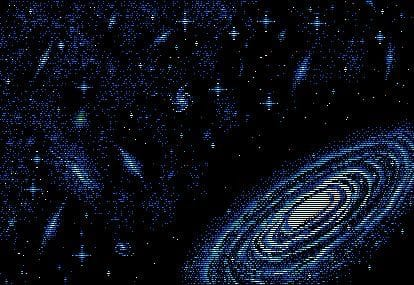
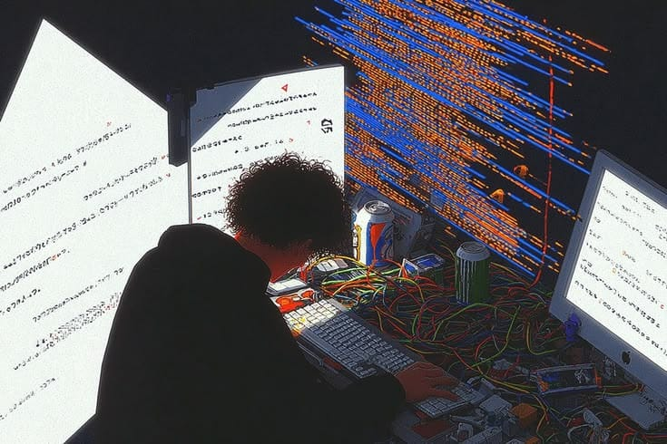

<!--
Profile: Janshu76
Email: janshumishra90@gmail.com
-->

<div align="center">
  
  <br />
  
</div>

## 👋 About Me

<table>
<tr>
<td width="60%" valign="top">

```js
const janshu = {
  role: "Backend-focused full-stack developer",
  building: "End-to-end products, from APIs to UI",
  learning: ["system design", "distributed systems", "caching", "scalability"],
  tech: {
    frontend: ["React", "TypeScript"],
    backend: ["Python", "FastAPI"],
    ai: ["LLM integration"],
    database: ["SQLite", "MySQL"]
  }
};
```

</td>
<td width="40%" align="center" valign="middle">
  
</td>
</tr>
</table>

> “I enjoy turning complex systems into simple, reliable building blocks.”

## 🌐 Connect With Me

<div align="center">
  <a href="mailto:janshumishra90@gmail.com" aria-label="Email Janshu"></a>
  <a href="https://github.com/Janshu76" aria-label="GitHub profile Janshu76"></a>
</div>

## 🧰 Tech Stack

<div align="center">
  
  <br /><br />
  
  
  
  
  
  
  
</div>

## 🏗️ What I'm Exploring (System Design)

<details>
<summary>Current areas of focus</summary>

- Load balancing and traffic distribution
- Caching strategies and invalidation
- Database indexing, replication, and scaling
- Message queues and asynchronous workflows
- Rate limiting and graceful degradation
- API versioning and backward compatibility

</details>

## 📊 GitHub Analytics

<div align="center">
  <picture><source media="(prefers-color-scheme: dark)" srcset="https://github-readme-stats.vercel.app/api?username=Janshu76&show_icons=true&bg_color=070B1D&title_color=FF9E64&text_color=C9D1FF&icon_color=7AA2FF&hide_border=true"><source media="(prefers-color-scheme: light)" srcset="https://github-readme-stats.vercel.app/api?username=Janshu76&show_icons=true&theme=default&hide_border=true"></picture>
  <br />
  <picture><source media="(prefers-color-scheme: dark)" srcset="https://streak-stats.demolab.com?user=Janshu76&background=070B1D&ring=FF9E64&fire=FF9E64&currStreakLabel=C9D1FF&sideLabels=C9D1FF&dates=8792B0&hide_border=true"><source media="(prefers-color-scheme: light)" srcset="https://streak-stats.demolab.com?user=Janshu76&theme=default&hide_border=true"></picture>
  <br />
</div>

## ✨ Let's build something scalable

<div align="center">
  
</div>

<!-- ASSETS PLAN
assets/banner.png — retro galaxy banner image; current image is 1500 × 420 px.
assets/about.png — multi-monitor developer image; recommended 760 × 500 px (current image is 735 × 490 px).
-->


